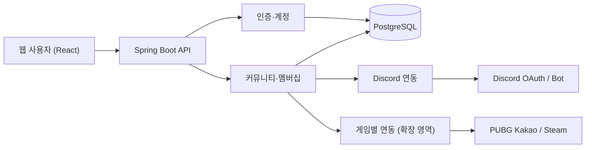

# Community Platform

> **클랜 운영에서 반복되던 확인과 판단을, 근거가 남는 커뮤니티 관리 시스템으로 옮기는 프로젝트**

이 저장소는 `community-platform`의 **개발 과정 포트폴리오**입니다. 전체 소스코드를 복제하기보다, **왜 만들었는지 → 무엇을 구현했는지 → 어떤 문제가 발생했는지 → 어떻게 판단하고 해결했는지**를 중심으로 정리합니다.

> **진행 상태 (2026-11-19 기준)**: 개발 진행 중. 아래에서 '구현·자동 테스트 확인'과 '실서비스 연동 검증 전'을 구분합니다. 기록은 개발 보고와 대화에서 확인한 범위이며, Obsidian 원본 전체와 실서비스 운영 결과를 검증한 보고서는 아닙니다.

## 1. 만들게 된 이유

배틀그라운드 클랜을 운영하면서 Discord 멤버·역할·게임 닉네임·경기 기록을 각각 확인해야 했습니다. 클랜원 활동 여부를 확인하거나 이벤트 팀을 구성할 때마다 사람이 목록을 비교하고 결과를 정리해야 했습니다.

처음에는 **간단한 Windows 관리 프로그램**으로 시작했고, 여러 데이터를 웹에서 연결하기 위해 **GuildUp**을 개발했습니다. 운영 경험과 기존 구현에서 겪은 문제를 바탕으로, 커뮤니티별 정책과 경계를 더 명확히 하는 **새 프로젝트 `community-platform`**을 설계·개발하고 있습니다.

목표는 무조건적인 자동화가 아닙니다. **정보 수집·대조는 시스템이 지원하고, 추방처럼 영향이 큰 조치는 운영자의 승인과 기록을 거치도록 만드는 것**입니다.

[개발 배경 자세히 보기](docs/01-background.md)

## 2. 해결하려는 문제

| 운영 현장의 문제 | 설계·구현 방향 |
| --- | --- |
| Discord 사용자와 게임 닉네임을 수동 대조 | 변경 가능한 이름 대신 **Discord 사용자 ID**를 식별 기준으로 사용 |
| 커뮤니티마다 게임과 운영 규칙이 다름 | 커뮤니티에 게임을 지정하고, 게임별 연동·정책의 경계를 분리 |
| 회원·클랜원·활동 상태가 혼재 | 플랫폼 사용자, 커뮤니티 회원, Discord 클랜원을 별도 개념으로 관리 |
| 연동 실패나 중복 요청 시 잘못된 조치 위험 | 승인, 중복 억제, 결과 불명 상태 등 운영 안전성 고려 |
| 구현은 되지만 문제 해결 이력이 흩어짐 | 기능별 결정 이유, 실패 원인, 검증 한계를 Markdown으로 축적 |

## 3. 기술 스택

| 구분 | 기술 |
| --- | --- |
| Backend | Java 21, Spring Boot 4.1.2, Spring Security, Spring Data JPA |
| 설계·데이터 | Spring Modulith, PostgreSQL, Flyway |
| Frontend | React, TypeScript, Vite |
| 외부 연동 | Discord OAuth2 / Bot(JDA), PUBG API(카카오·스팀 구분) |
| 테스트 | JUnit·Spring 테스트, 프론트엔드 빌드 검증 |
| 문서화 | Obsidian, Markdown, 아키텍처 결정 기록(ADR) |

일부 연동과 게임 기능은 설계 또는 후속 개발 대상입니다. 기술 목록이 곧 모든 기능의 운영 완료를 뜻하지는 않습니다.

## 4. 개발 단계별 기록

| 단계 | 핵심 내용 | 확인 수준 |
| --- | --- | --- |
| 기반·인증 | 이메일·Discord 인증 및 계정 연결 구조 | 코드·자동 테스트 보고 확인, 실사용 흐름은 별도 검증 필요 |
| 커뮤니티 | 비공개 커뮤니티, 커뮤니티당 게임 1개, 가입 승인 정책, 역할 분리 | 구현 보고 기반 |
| 멤버 관리 | OWNER / ADMIN / MEMBER, ACTIVE / LEFT / KICKED 등 회원 상태 | 구현 보고 기반 |
| Discord 연동 | 서버 연결·봇 설치 확인, 역할에 따른 클랜원 동기화 | 자동 테스트 보고 확인, 실제 Discord 연동 검증 전 |
| 회원 자동 연결 | 동기화된 클랜원과 로그인 계정의 Discord ID 정확 일치 시 MEMBER 연결 | 2026-11-18 구현 보고, 실환경 검증 전 |
| 게임 활동 | PUBG Kakao / Steam 분리, 닉네임 파싱과 활동 집계 | 설계·기존 GuildUp 경험을 바탕으로 이관/구현 상태 확인 필요 |

[기능과 진행 상태 자세히 보기](docs/02-features.md)

## 5. 아키텍처에서 중요하게 생각한 점

- **커뮤니티 경계:** 다른 커뮤니티의 회원·운영 데이터가 섞이지 않도록 식별자와 권한을 함께 검증합니다.
- **식별의 안정성:** 닉네임이나 이메일 추정 매칭 대신 검증된 Discord 사용자 ID를 사용합니다.
- **관리자 승인:** 활동 부족 판정이 곧바로 추방으로 이어지지 않도록 결정과 실행을 분리합니다.
- **점진적 개발:** 설계, 자동 테스트, 실제 외부 서비스 검증을 별도 단계로 봅니다.

[설계 선택과 그 이유](docs/04-decisions.md)

## 6. 문제 해결 기록

단순히 성공한 기능보다, **실패한 조건을 어떻게 발견하고 재발을 막으려 했는지**를 기록합니다.

| 사례 | 문제의 핵심 | 확인된 대응 |
| --- | --- | --- |
| SMTP 설정으로 애플리케이션 기동 실패 | 포트 환경변수에 붙은 세미콜론이 정수 변환 실패 유발 | 원인 식별 및 환경변수 형식 점검 |
| Discord 봇 설치 오판 | 애플리케이션 설치만으로 봇 참여를 성공 처리할 위험 | 봇 사용자·서버 멤버·Guild 상태 검사 보강 |
| Discord 클랜원 자동 연결 | 닉네임 매칭은 변경·중복 가능성이 있음 | Discord 고유 ID 정확 일치, 기존 역할·탈퇴 상태 보존 |
| 외부 조치의 중복·결과 불명 | 요청 결과가 불확실한 상태에서 재시도 시 중복 조치 위험 | 기존 GuildUp 사고 경험을 차기 승인/조치 설계에 반영 |

[문제 → 원인 → 대응 → 검증 → 남은 과제](docs/03-troubleshooting.md)

## 7. 앞으로 보완할 것

실제 Discord/메일/DB 통합 검증, PUBG 게임별 데이터 수집 검증, 커뮤니티 간 데이터 격리 테스트, 화면 캡처·시연 시나리오, 구현 이력의 Obsidian 원문 대조를 진행할 예정입니다. **테스트 통과와 외부 서비스에서의 정상 동작을 같은 의미로 쓰지 않습니다.**

[검증 기록 및 후속 과제](docs/05-validation.md)

---

**문서 안내:** 이 저장소는 소스코드 저장소와 구분되는 공개 포트폴리오입니다. 비밀키·토큰·실제 회원 식별자·민감 로그는 게시하지 않습니다.
