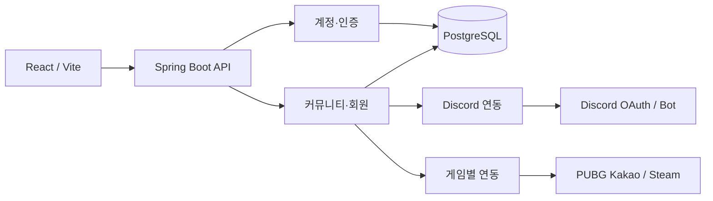

# community-platform

**Discord와 게임 데이터를 연결해 클랜 운영을 돕는 웹 서비스**

배틀그라운드 클랜을 운영하면서 가장 번거로웠던 일은 게임을 하는 것보다 그 밖의 관리 업무였습니다. 새로운 클랜원이 들어오면 Discord와 게임 닉네임을 대조해야 했고, 활동 여부를 확인하려면 경기 기록을 하나씩 살펴봐야 했습니다. 이벤트를 열 때도 참가자와 결과를 따로 정리해야 했습니다.

이 작업을 줄여보려고 처음에는 Windows 관리 프로그램을 만들었습니다. 이후 Discord와 PUBG 데이터를 웹에서 함께 다루는 **GuildUp**을 개발했고, 운영하면서 느낀 불편과 기존 구조의 한계를 반영해 **community-platform**을 새로 만들고 있습니다.

단순히 관리 기능을 많이 넣는 것보다, **반복 작업은 줄이고 운영자가 판단해야 하는 부분은 명확하게 남기는 것**이 목표입니다.

> 개인 프로젝트 · 개발 진행 중

## 어떤 문제를 해결하려고 했나

| 기존에 불편했던 점 | 접근 방식 |
| --- | --- |
| Discord 닉네임과 게임 계정을 계속 대조해야 함 | Discord 고유 ID를 기준으로 회원을 연결하고 게임 계정은 별도로 관리 |
| 클랜원 활동을 일일이 확인해야 함 | PUBG 경기 기록을 바탕으로 활동을 조회하는 기능 개발 |
| 커뮤니티마다 운영 규칙이 다름 | 커뮤니티별 게임과 가입 정책을 분리 |
| 봇이 잘못된 대상을 처리하면 되돌리기 어려움 | 권한 확인, 관리자 승인, 처리 이력을 고려해 운영 기능 설계 |
| 새로운 게임을 추가할 때 기존 기능을 건드려야 함 | 공통 커뮤니티 기능과 게임별 연동을 나눠 확장 가능한 구조로 설계 |

## 주요 기능

### 계정과 커뮤니티

- 이메일 가입·로그인과 이메일 인증
- Discord 로그인 및 기존 계정과 Discord 계정 연결
- 비공개 커뮤니티 생성, 커뮤니티당 게임 선택
- 관리자 승인 기반 가입과 OWNER / ADMIN / MEMBER 권한 구분

### Discord 연동

- Discord 서버 연결과 클랜원·역할 정보 동기화
- 로그인 계정과 클랜원 정보의 Discord ID를 비교해 회원 연결
- 기존 운영진 권한이나 탈퇴·추방 이력이 자동 연결로 변경되지 않도록 처리

### 게임 활동 관리

- PUBG Kakao와 Steam을 구분하는 연동 구조
- Discord 표시명에서 게임 닉네임을 추출하는 규칙 검토
- 경기 기록을 이용한 활동 판정과 게임별 관리 기능 확장

게임 연동과 활동 관리 중 일부는 현재 개발 중이며, 기존 GuildUp에서 사용하던 기능을 그대로 완료된 것으로 표기하지 않았습니다.

[기능별 구현 내용](docs/02-features.md)

## 사용 기술

| 구분 | 기술 |
| --- | --- |
| Backend | Java 21, Spring Boot, Spring Security, JPA |
| Database | PostgreSQL |
| Frontend | React, TypeScript, Vite |
| Integration | Discord OAuth2, Discord Bot(JDA), PUBG API |
| Architecture | 모듈러 모놀리스 방향, Spring Modulith 검토 |
| Documentation | Markdown, Obsidian |

## 구조

커뮤니티 회원과 Discord 클랜원을 같은 개념으로 취급하지 않았습니다. 서비스 가입 여부, Discord 서버 소속, 클랜 활동 상태는 서로 다르기 때문입니다. 특히 자동 회원 연결은 닉네임이 아닌 Discord 사용자 ID를 기준으로 처리합니다.

[구조를 이렇게 잡은 이유](docs/04-decisions.md)

## 개발하면서 고민한 부분

**1. 닉네임으로 회원을 연결해도 될까?**

Discord 표시명은 누구나 변경할 수 있고 중복될 수도 있습니다. 잘못된 계정이 연결되는 상황을 피하려고 Discord 고유 ID를 기준으로 매칭하고, 기존 회원 권한과 탈퇴 기록은 유지하도록 했습니다.

**2. 봇을 초대했는데 왜 역할이 없을까?**

봇 설치와 서버 역할 설정이 별개라는 점을 확인했습니다. 권한을 단순히 요청하는 것으로 끝내지 않고, 봇 역할의 위치와 필요한 Intent까지 점검해야 했습니다.

**3. 외부 API 작업이 실패했을 때 다시 실행하면 될까?**

기존 GuildUp에서 추방 요청이 취소된 상황과 결과를 확인할 수 없는 상황을 구분하는 작업을 했습니다. 같은 요청을 무조건 재시도하면 중복 조치가 생길 수 있어, 새 프로젝트에서도 실행 상태와 승인 과정을 별도로 다루려고 합니다.

[문제 해결 기록 자세히 보기](docs/03-troubleshooting.md)

## 개발 기록

- [프로젝트를 시작한 이유](docs/01-background.md)
- [기능별 구현 내용](docs/02-features.md)
- [문제 해결 과정](docs/03-troubleshooting.md)
- [기술 선택과 설계 고민](docs/04-decisions.md)
- [테스트 및 남은 작업](docs/05-validation.md)

현재는 인증·커뮤니티·Discord 연동을 중심으로 개발하고 있습니다. 게임별 활동 집계와 운영 자동화는 실제 데이터를 연결하고 검증하면서 확장할 계획입니다.
